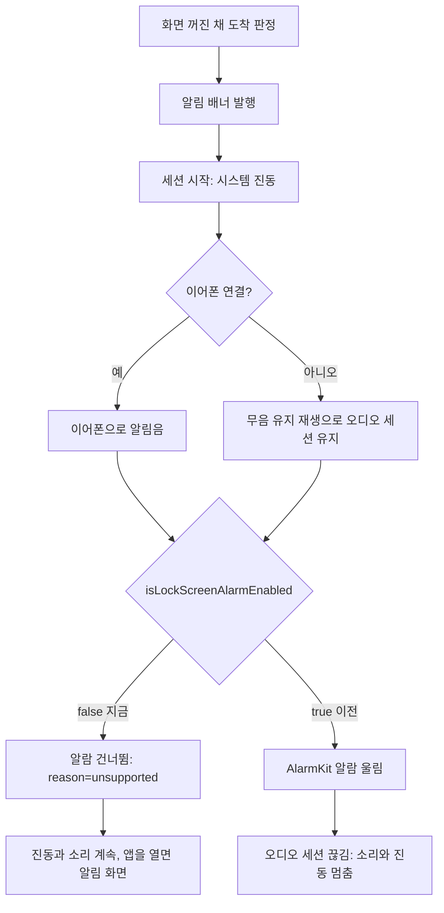

### 📌 작업 개요

iOS 26 의 잠금 화면 알람(AlarmKit)을 끈다. 실기기 진단 기록에서 **알람이 울리는 순간 앱 오디오 세션이 끊겨 이어폰 소리와 백그라운드 진동이 함께 멈추는 것**을 확인했다. 알람 자체도 진동하지 않으므로, 화면이 꺼진 채 도착하면 진동 없는 알람 화면만 남았다.

**보고된 증상**: v1.38.0, iPhone 15(iOS 26.3.1). 도착 직후 소리가 나다가 곧 무음이 되고 진동도 울리지 않음

### 🔍 원인 — 실기기 진단 기록 (2026-10-22 18:23 KST)

| 시각 | 기록 | 의미 |
|---|---|---|
| 23:38.084 | `[alert] session start ... sound=true vibration=strong` | 화면 꺼진 채 세션 시작 |
| 23:38.088 | `system vibration first pulse` | 진동 시작 |
| 23:38.107 | `audio decision headphones=true ... result=headphones` | 이어폰 재생 (정상) |
| 23:40.204 | `[alarm] state ... alerting` | AlarmKit 알람 울림 |
| 23:41.231 | `[alert] audio interruption begin type=unknown` | **알람이 오디오 세션을 가져감** |
| 23:48 ~ 25:38 | `background reminder posted n=1..12` | 무음 알림만 반복 |
| 26:56.514 | `[alarm] stopped by user` | 사용자가 알람 끔 |
| 26:56.705 | `audio interruption end type=pause` | 3분 15초 만에 끊김 해제 |

- 같은 순서(`alerting` → 약 1초 뒤 `audio interruption begin` → 알람을 끌 때 `end`)가 10-10 에 두 번 더 있다
- 오디오가 끊긴 백그라운드 앱은 `kSystemSoundID_Vibrate` 진동도 무시된다(결정 059 의 추정과 같은 현상)
- #252 에서 넣은 "거의 무음 알람음(`alarm_haptic.caf`)으로 알람 진동 끌어내기"도 효과가 없었다 — 파일은 little-endian, 최대 진폭 3(약 -80dBFS)으로 정상이었다
- 스피커로 기본 알람음이 샌 것은 **아니다** — 들린 소리는 이어폰 판정을 통과한 정상 재생이었다

### ✅ 구현 내용

#### 스위치 한 곳으로 끄기
- **파일**: `lib/app/arrival_alarm_providers.dart`
- **변경 내용**: `isLockScreenAlarmEnabled = false` 상수를 두고, iOS 에서도 `UnsupportedArrivalAlarm` 을 돌려준다. 꺼질 때 `[alarm] lock screen alarm disabled reason=switch_off` 를 남긴다
- **이유**: 알람 표시·권한 요청·홈 경고(`ReliabilityGap.lockScreenAlarm`)가 모두 이 provider 의 `status()`/`present()` 를 거친다. 한 곳만 막으면 전부 따라 꺼진다. Swift `ArrivalAlarm` 과 알람음 파일, `NSAlarmKitUsageDescription` 은 남겨 두어 다시 켜는 것이 한 줄이다

#### 설정 줄 숨김
- **파일**: `lib/app/routes/settings_route.dart`
- **변경 내용**: `lockScreenAlarm` 을 `Platform.isIOS && isLockScreenAlarmEnabled` 일 때만 내려준다
- **이유**: 스위치만 끄면 status 가 `supported=false` 가 되어 "iOS 26 이상에서 쓸 수 있어요" 안내가 iOS 26 기기에도 떠서 틀린 말이 된다

#### 문서
- `docs/10-DECISIONS.md` 결정 074 추가 (057 2·3번, 059 3번을 뒤집음)
- `docs/05-PLATFORM.md` · `docs/06-UX.md` · `docs/11-ROADMAP.md` · `CLAUDE.md` 에 "꺼져 있다" 표시

### 🧪 검증

- `flutter analyze` — No issues found
- `flutter build ios --simulator --debug` — 성공
- 자동 테스트는 결정 070 으로 레포에 없다
- **실기기 미검증**: 화면 꺼진 채 도착 시 진단 기록에 `[alarm] skipped ... reason=unsupported` 가 남고, 그 뒤 `audio interruption begin` 없이 진동·이어폰 소리가 이어지는지 확인 필요

### ⚠️ 주의사항

- **스위치를 다시 켜려면 먼저 "AlarmKit 이 앱 오디오 세션을 끊지 않는가"를 실기기에서 확인한다.** 끊는 한 켜는 순간 이어폰 소리와 백그라운드 진동이 같이 죽는다
- 잃는 것: 잠금 화면 전체를 덮는 알람 화면. 잠금 화면에는 알림 배너만 남는다
- 이 배포 이전 버전에서 울리던 알람이 남아 있으면 사용자가 잠금 화면에서 직접 꺼야 한다(꺼진 경로에서는 `stopAll` 이 네이티브까지 가지 않는다)
- 화면 꺼진 상태의 백그라운드 진동이 이어지는지(결정 059 무음 유지 재생 경로)는 여전히 실기기로만 닫힌다
