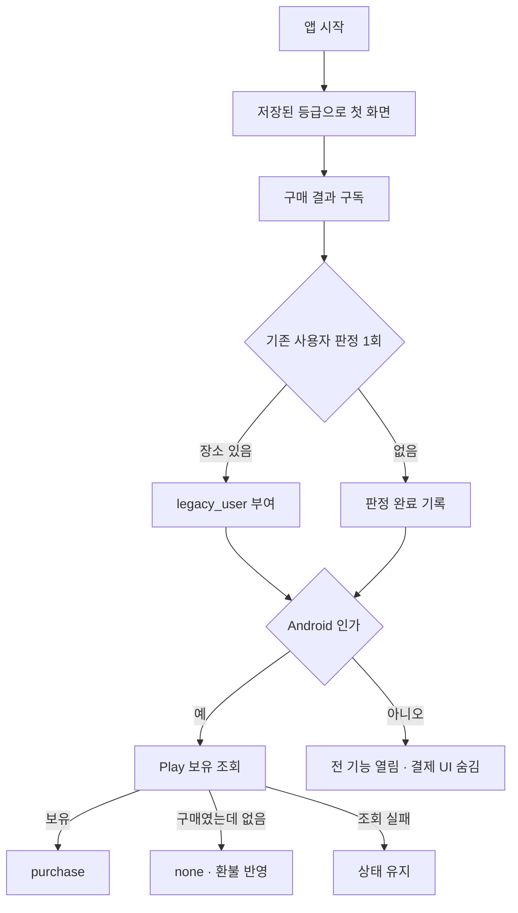

### 📌 작업 개요

Android 에서 일회성 상품 `pro_unlock`(평생 이용권, ₩6,500, 구독 아님)을 팔고, 앱 전체에 무료/프로 경계를 적용했다. 판매 1건당 수수료(15%)·부가세 제외 약 5,000원이 목표다. iOS 는 실기기 검증이 덜 되어 이번에 바꾸지 않았다(전 기능 무료 + 광고 그대로).

| 기능 | 무료 | 프로 |
|---|---|---|
| 장소 | 1개 | 제한 없음 (실제 상한 30) |
| 도착·출발, 알림 시간대, 진동 세기 | ✓ | ✓ |
| 이어폰 알림음 | 기본음 1개 | 프리셋 전체 + 내 음원 |
| 장소 백업·가져오기 | 불가 | ✓ |
| 광고 | 있음 | 없음 |

- 커밋: `5965263`(기능), `f77887d`(문구·버튼 다듬기)
- 설계: `docs/superpowers/specs/2026-10-21-pro-lifetime-purchase-design.md`, 결정 072

### 🔍 문제 분석

수익원이 알림 해제 뒤 전면광고와 하단 띠뿐이라 구조적으로 작았고, 돈을 낼 이유가 없었다. 경계를 화면마다 따로 두면 "무료 상한"과 "OS 한도"가 섞이고, 환불·기존 사용자·iOS 같은 경우가 화면마다 다르게 처리될 위험이 컸다.

### ✅ 구현 내용

#### 등급 판단 단일 원본
- **파일**: `lib/core/entitlement/` (`place_limits.dart`, `pro_entitlement.dart`, `feature_access.dart`, `feature_access_controller.dart`)
- **변경**: 플랫폼 + 프로 출처(none/purchase/legacy_user) → `FeatureAccess` 하나로 상한·알림음·백업·광고 여부를 계산한다.
- **이유**: places·sounds·settings·ads 가 pro feature 를 몰라도 되게(feature 간 import 금지). `PlaceValidator.maxPlaces` 를 없애고 등록 검증·백업 가져오기·감시 동기화가 모두 여기서 읽는다.

#### Play 결제
- **파일**: `lib/features/pro/data/play_pro_purchase_service.dart`, `lib/app/pro_access_coordinator.dart`
- **변경**: 상품 조회 → 결제 창 → 구매 확인(acknowledge) → 이벤트. 앱 시작·복귀 때 보유 조회로 상태를 맞추고(보유 > 프로, 구매였는데 없음 > 무료, 조회 실패 > 유지), 업데이트 후 첫 실행에 장소가 있으면 기존 사용자 혜택을 준다.
- **이유**: 로그인·서버 없이 Play 가 구글 계정에 구매를 묶어 둔다. 재설치·기기 변경은 "이미 구매했나요? 복원하기"로 되찾는다.

#### 화면
- **파일**: `lib/features/pro/presentation/`, `lib/core/ui/components/locked_content_blur.dart`, `lib/app/routes/pro_gate.dart`
- **변경**: 비교표형 프로 안내 시트, 홈 FREE/PRO 칩, 설정 맨 위 카드(무료는 유도 카드, 프로는 한 줄), 잠긴 기능 블러 + "평생 이용권으로 열기" 버튼(자물쇠 없음)을 알림음·장소 추가·백업 세 곳에 적용했다. 프로면 하단 띠·전면광고·광고 동의 창을 요청하지 않는다.

### 🔧 주요 변경사항 상세

- **장소 상한 30**: Android 지오펜스는 앱당 100개인데 장소 1개가 원 3개(본·근접·바깥)를 쓴다. 넘기면 등록 요청 전체가 실패해 모든 알림이 꺼질 수 있다.
- **감시 동기화는 등급이 아니라 플랫폼 한도로 자른다**: 환불로 무료가 된 사용자의 기존 장소도 계속 울려야 한다.
- **광고 띠 트리 모양 유지**: 프로가 되는 순간 위젯 트리 모양이 바뀌면 감싼 화면(입력 중인 장소 폼 포함)이 처음부터 다시 만들어진다. 띠만 조건부로 뺀다.
- **구매 확인 결과 직접 확인**: `InAppPurchase.completePurchase` 는 실패를 버린다. Android 플랫폼을 직접 불러 응답 코드로 판정하고, 실패하면 다음 보유 조회(시작·앱 복귀)에서 다시 확인한다. 3일 안에 확인하지 않으면 Play 가 자동 환불한다.
- **결제 창을 닫은 결과는 상품 ID 가 빈 문자열로 온다**: 이걸 거르면 시트가 "진행 중"에 멈춘다. 빈 ID 결과도 진행 중 흐름의 결과로 처리하고, 이미 보유한 계정(ITEM_ALREADY_OWNED)은 복원으로 처리한다.

**검증**
- `flutter analyze` 0건, 디버그 APK 빌드 성공
- 별도 리뷰어의 전체 리뷰 → 결함 6건(Important) + 사소한 항목 수정 후 재분석 0건
- 에뮬레이터(Android 16, `--dart-define=PRO_DEBUG_SOURCE=none|purchase`): 무료 칩·시트·설정 카드·백업 블러·알림음 블러·장소 1개 후 잠금 미리보기, 프로 칩·한 줄 표시·잠금 해제 확인

| 무료 홈 | 프로 안내 시트 | 무료 설정 | 백업 잠금 |
|---|---|---|---|
|  |  |  |  |

| 알림음 잠금 | 장소 추가 잠금 | 프로 홈 | 프로 설정 |
|---|---|---|---|
|  |  |  |  |

에뮬레이터에는 Play 상품이 없어 시트 버튼이 "가격 확인 중…"에 머물렀다(캡처 시점). 이후 상품을 못 읽으면 버튼이 "평생 이용권"(비활성) + 사유 문구로 바뀌도록 고쳤다(`f77887d`).

### ⚠️ 주의사항

- **감시 동기화 상한을 `FeatureAccess.placeLimit` 로 바꾸지 말 것** — 환불·무료 전환 시 기존 장소 알림이 끊긴다. `PlaceLimits.platformMaximum()` 만 쓴다.
- **`AdBannerFrame` 에서 프로일 때 `return widget.child` 처럼 트리를 바꾸지 말 것** — 구매 순간 화면이 초기화된다.
- **결제 UI 를 알림 화면·해제 직후·온보딩에 두지 말 것** — 광고 정책과 같은 이유(우발적 탭). 알림 해제는 광고·결제를 기다리지 않는다.
- **장소당 원 개수를 늘리면 상한 30 을 다시 계산해야 한다** (`GeofenceRegistrar.kt` ↔ `PlaceLimits.androidProPlaces`).
- iOS 는 기존 사용자 판정만 기록하고 화면에는 아무것도 없다. iOS 결제를 붙일 때 이 기록을 그대로 쓴다.

**남은 작업**
- 사용자 작업: Play Console 판매자 결제 프로필 완료 → 일회성 상품 `pro_unlock`(₩6,500) 생성 → 라이선스 테스터 등록
- 실기기: 실제 결제·복원·환불 감지·결제 대기(pending)·재설치 후 복원
- 브랜치 푸시·develop 병합·배포 (main 배포 시 iOS 는 심사까지 자동 제출됨 — 결정 071)
