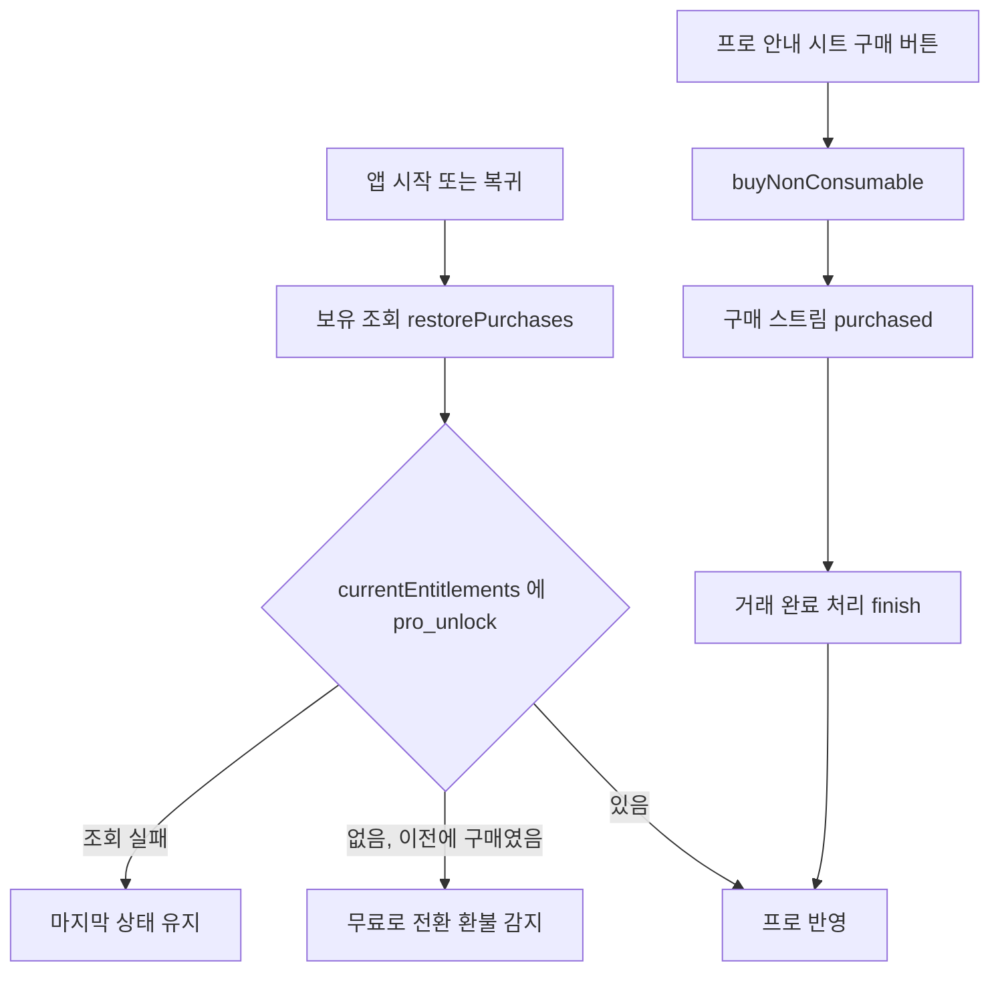

### 📌 작업 개요

iOS 에도 Android 와 같은 평생 이용권(비소모성 상품 `pro_unlock`, 한 번 결제)을 붙였다. 무료/프로 경계·프로 안내 시트·블러·FREE/PRO 표시·광고 제거·복원은 Android 코드를 그대로 쓰고, **결제 창구만 iOS 용으로 추가**했다. 가격 기준은 사용자 결정대로 **건당 순수익 5,000원 이상**이다.

### ✅ 구현 내용

#### iOS 결제 창구
- **파일**: `lib/features/pro/data/store_kit_pro_purchase_service.dart` (신규)
- 상품 조회 > `buyNonConsumable` > 거래 완료 처리(finish) 흐름. 미완료 거래는 상태와 무관하게 finish 한다 (안 하면 실행마다 다시 옴).
- **보유 조회는 StoreKit 2 `currentEntitlements`** (`restorePurchases`). 로그인 창이 뜨지 않아 앱 시작·복귀마다 불러도 되고, 환불된 구매는 빠져 Android 와 같은 환불 감지가 된다. 조회 중 도착한 복원 거래는 결과로만 쓰고 이벤트로 보내지 않는다.
- 구매 시각은 StoreKit 2 의 `yyyy-MM-dd HH:mm:ss`(기기 시간대)와 StoreKit 1 의 epoch 밀리초를 모두 읽는다.

#### 스토어 구분 한 곳
- **파일**: `lib/features/pro/domain/pro_purchase_service.dart`, `play_pro_purchase_service.dart`, `pro_purchase_providers.dart`
- `ProPurchaseService.store`(googlePlay·appStore·none) 추가. 제공자는 Android > Play, iOS > StoreKit, 그 외 > 없음.
- **이유**: Play 전용 화면 요소가 세 곳(결제 창구, 코드 사용 버튼, 구매 계정 안내)이라 화면마다 `Platform` 을 보지 않고 결제 창구가 스토어를 알려주게 했다.

#### 화면
- `pro_offer_sheet.dart`: 프로모션 코드 버튼은 Play 일 때만. App Store 비소모성 상품의 오퍼 코드 지원 여부를 확인하지 못해 iOS 에서는 숨겼다.
- `pro_info_sheet.dart` + 네 언어 arb: App Store 는 "Apple 계정으로 구매됐어요" 문구(`proInfoNotePurchaseAppStore`).

#### 유료화 스위치
- `feature_access_controller.dart`: `isPaywallEnabled = Android || iOS`.
- 업데이트 후 기존 iOS 사용자도 무료로 시작한다(결정 072 개정과 같음). 감시 상한은 등급과 무관한 OS 한도(iOS 20)라 **이미 등록한 장소는 계속 울리고 추가만 막힌다.**

#### 문서
- 결정 075, `07-MONETIZATION`, `11-ROADMAP`, 설계 `docs/superpowers/specs/2026-10-23-ios-pro-purchase-design.md`

### 🧪 검증

- `flutter analyze` — No issues found
- `flutter build ios --simulator --debug` — 성공
- 자동 테스트는 레포에 없다(결정 070)
- **실기기·샌드박스 미검증**: 구매, 재설치 후 복원, 환불 감지, Ask to Buy(pending)

### ⚠️ 주의사항

- **App Store Connect 유료 앱 계약이 "신규"(미서명)다.** 서명 전에는 상품을 팔 수 없다. 법인 정보 업데이트 > 계약 서명 > 상품 `pro_unlock` 생성·가격 > **이 기능이 든 새 버전과 함께 심사 제출** 순서가 출시 전 필수다.
- 그래서 **develop 에 합치지 않고 기능 브랜치에만 올렸다.** main 배포는 iOS 심사 자동 제출(결정 071)이라, 계약 전에 나가면 iOS 사용자가 결제할 수 없는 채로 무료로 묶인다.
- 가격: 소규모 사업자 프로그램(15%)이면 ₩6,500 ≈ 5,023원, 수수료 30%면 약 ₩7,900 이상이어야 순수익 5,000원을 넘는다. 애플 원화 가격 단계는 상품을 만들 때 확인한다.
- `AppStore.sync()` 는 로그인 창을 띄우므로 쓰지 않았다. 보유 조회를 바꿀 때 이 점을 지킨다.
