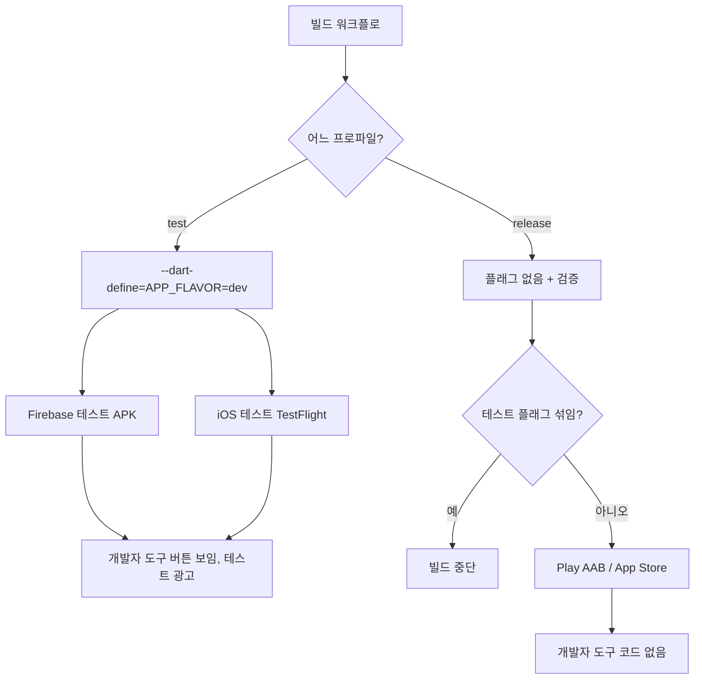

<!-- projectops:report -->
## 개요

테스트 빌드에서만 보이는 개발자 도구를 넣었다. Firebase App Distribution 테스트 배포도 처음으로 연결했다. 개발자 도구는 Firebase 테스트 APK와 iOS 테스트 TestFlight에만 들어가고, Play·App Store 정식 빌드에서는 코드째 빠진다.

## 변경 사항

| 파일 | 내용 |
|---|---|
| `lib/core/config/app_build_flavor.dart` (신규) | 컴파일 상수 `APP_FLAVOR=dev` > `isDevBuild`, `canUseDevTools`(디버그 포함), 표시 이름 |
| `lib/app/dev_tools/*` (신규 7개) | 끌어 옮기는 버튼(overlay), 시트, 탭 3개(등급·상황·진단), 동작 모음, 결과 토스트 실행기 |
| `lib/core/entitlement/feature_access_controller.dart` | 화면 상태 = 강제값 ?? 저장 출처. `storedSource`·`setDevOverrideSource` 추가 |
| `lib/app/pro_access_coordinator.dart` | 환불 판정이 화면 상태가 아니라 저장 출처를 보게 |
| `lib/core/config/ad_unit_ids.dart` | 개발 빌드는 `DEV_FLAG` 와 무관하게 테스트 광고 |
| `ad_frequency_store` · `review_prompt_store` · `review_prompt_coordinator` | 개발자 도구용 초기화·바로 요청 메서드 |
| `lib/core/l10n/arb/*` | 개발자 도구 문구 48개, 네 언어 |
| `.github/config/build-profile.json` (신규) | `test` = `APP_FLAVOR=dev`, `release` = 없음 |
| `PROJECT-FLUTTER-ANDROID-TEST-APK.yaml` | test 프로파일 적용, Firebase 앱 ID·테스터 그룹 `testers` |
| `PROJECT-FLUTTER-IOS-TEST-TESTFLIGHT.yaml` | test 프로파일 적용. App Store에서 출시돼 닫힌 버전이면 다음 패치로 빌드(템플릿 `ios_release.py precheck-version`, ASC 키 사전 설치) |
| `PROJECT-FLUTTER-ANDROID-PLAYSTORE-CICD.yaml` | release 프로파일 검증 — 테스트 플래그가 섞이면 빌드 중단 |
| `docs/07` · `docs/08` · `docs/10` 087 | 광고 표, 테스트 빌드·Firebase 운영 정보, 결정 기록 |

### 개발자 도구 기능

| 탭 | 기능 |
|---|---|
| 등급 | 실제 값 / 무료로 보기 / 프로로 보기, 화면 등급·저장 등급·장소 한도·구매 주문 번호 |
| 상황 | 도착·출발 알림 바로 울리기, 전면광고 바로 보기, 광고 빈도 초기화, 후기 조건 초기화·바로 요청, 온보딩 다시 보기 |
| 진단 | 빌드 종류·버전·광고 단위, 지오펜스 다시 등록, 드라이브 지금 동기화, 상태 전체 복사, 진단 기록 열기 |

### 빌드별 흐름

## 왜 이렇게 했나

- **Play 트랙에는 넣을 수 없다.** 내부·비공개·정식이 같은 AAB를 승급하므로, 앱 안에서 트랙을 가를 방법이 없다. 그래서 별도 테스트 빌드에만 컴파일 상수로 넣었다.
- **컴파일 상수 한 겹이다.** passQL은 `.env` 값과 두 겹으로 막지만, 이 앱은 Dart가 `.env`를 읽지 않는다. 대신 release 프로파일 검증이 정식 빌드에 테스트 플래그가 섞이면 멈춘다.
- **테스트 광고 고정.** 테스트 APK는 정식 `.env`로 빌드된다. `DEV_FLAG=false`이면 테스터 기기에 실제 광고가 나갈 수 있었다(CLAUDE.md 규칙 8).
- **등급 강제는 저장하지 않는다.** 화면만 바꾸고, 구매·환불 판정은 저장 출처를 본다. 강제값 때문에 실제 구매자가 무료로 저장되는 일을 막는다.
- **시험 알림은 실제 경로를 탄다.** 대기 알림을 저장하면 앱 폴링(3초)이 실제 승격 경로로 알림 화면을 띄운다. 진동·이어폰 판정을 따로 흉내 내지 않는다.
- **Firebase 프로젝트를 분리했다.** Drive OAuth용 Cloud 프로젝트 `earlocalert`에 Firebase를 붙이면, 나중에 Firebase 프로젝트를 지울 때 OAuth 프로젝트까지 지워진다. 그래서 `earlocalert-84d44`를 새로 만들었다.

## 검증

- `flutter analyze` 문제 없음, `flutter test` 41개 통과
- `apply_build_profile.py`: test는 `--dart-define=APP_FLAVOR=dev`를 넣고, release는 검증을 통과했다.
- Android 테스트 APK (run 42441313106): `플래그: --dart-define=APP_FLAVOR=dev`로 빌드됐고, Firebase에 `1.49.0 (13)`으로 올라갔다. 콘솔에서 **초대됨 1**(chan4760@gmail.com)을 확인했다.
- iOS 테스트 TestFlight: 첫 실행(run 42440717591)은 업로드에서 거부됐다(`CFBundleShortVersionString [1.49.0] must contain a higher version than that of the previously approved version [1.49.0]`). 다음 패치로 올리게 고친 뒤 다시 실행했다(run 42442206213). 사전 점검이 `1.49.0 출시되어 닫힘, 빌드 버전 1.49.1`로 판정했고, 결과는 `Successfully distributed build to Internal testers`다.
- 실기기 Android (Galaxy SM-F766N, Firebase로 설치)
  - 개발자 도구 버튼이 보이고, "상태 전체 복사"가 동작했다.
  - 복사 결과: `flavor=dev`, `ads=test`, `dev_flag=false`. `.env`만 따랐다면 이 기기에 **실제 광고**가 나갔을 것이다. 테스트 광고 고정이 실제로 필요했다는 근거다.
  - Pro: `pro_stored=purchase`. Firebase 설치에서도 Play 보유 조회로 구매를 되찾았다.
  - Drive 동기화로 장소 3개를 가져왔다(`cloud_sync_last_synced_at` 기록됨). 감시 서비스 `running=true`, 지오펜스 3개가 등록됐다.
- **미검증:** 에뮬레이터 실행 화면. 이 Mac의 메모리 예산이 넘쳐 기기를 켜지 못했다. 시험 알림·등급 강제·iOS 실기기 동작은 아래 항목으로 남긴다.

## 주의할 점

- 백그라운드 엔진은 등급 강제값을 모른다. 장소 상한은 OS 한도만 본다.
- 테스트 APK는 업로드 키로 서명돼 Play에서 받은 앱과 서명이 다르다. 한 기기에 번갈아 깔려면 먼저 지운다.
- `PROJECT-FLUTTER-ANDROID-FIREBASE-CICD.yaml`의 앱 ID는 `your-firebase-app-id` 그대로다. 실행 기록이 없는 워크플로라 건드리지 않았다.
- 서비스 계정 키는 GitHub 시크릿에만 있다. 키를 바꿀 때는 Cloud 콘솔 `github-app-distribution@earlocalert-84d44`에서 새 키를 만들어 시크릿을 갱신하고, 옛 키를 지운다.

## 남은 일

- develop 병합: 다음 정식 배포 때 함께 나간다. 정식 빌드에는 개발자 도구 코드가 빠지므로 사용자에게 보이는 변화는 없다.
- 아래 실기기 확인 항목

## 실기기 확인 항목

- 알림 화면에서 렌치 버튼이 사라지는지 (보이는 것은 Android에서 확인)
- iOS TestFlight 1.49.1에서 버튼이 보이는지, 진단 탭의 빌드 종류가 `dev`인지
- 무료로 보기 > 장소 추가가 잠기는지, 앱을 다시 켜면 원래 등급으로 돌아오는지
- 도착 알림 바로 울리기 > 3초 안에 알림 화면, 진동, 이어폰을 꽂았을 때 소리
- 진단 탭에서 광고 단위가 "테스트"로 나오는지
