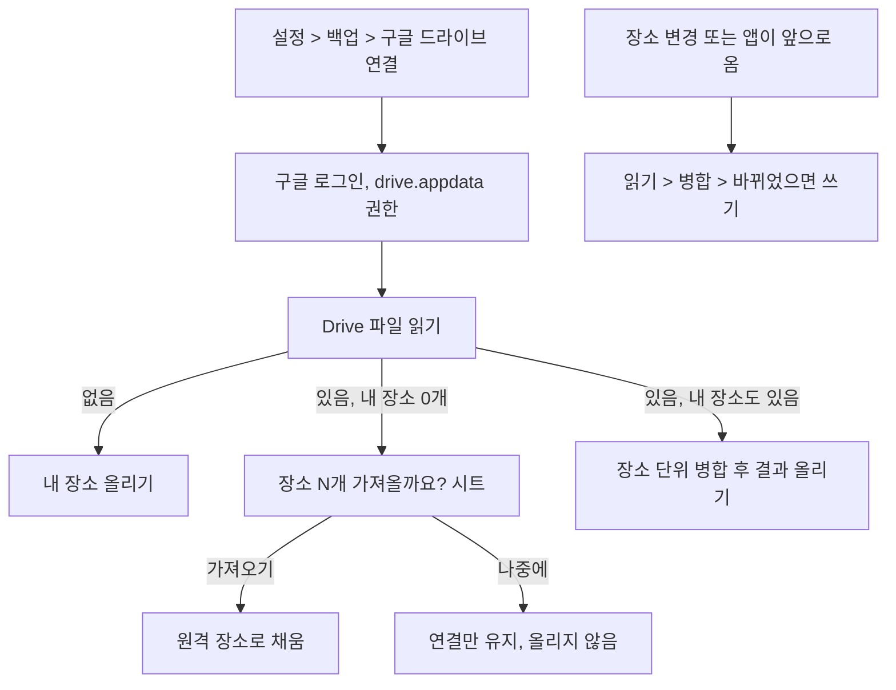

# Google Drive 클라우드 동기화 설계 (#330)

## 왜

사용자가 실제로 겪는 장면은 두 가지다.

1. **앱을 지웠다 다시 깔았을 때** 장소가 그대로 돌아와야 한다.
2. **다른 기기에서 같은 구글 계정으로 깔았을 때** 장소가 따라와야 한다. iPhone 으로 바꿔도 마찬가지다.

지금 자동 백업(#314)은 사용자가 고른 폴더에 파일을 쓴다. 복원하려면 그 파일을 직접 찾아 불러와야 하고, 기기를 바꾸면 파일을 옮겨야 한다. 사용자는 "구글 드라이브에 동기화되는" 다른 앱의 경험을 원한다.

## 목표

- 구글 계정으로 한 번 연결하면 장소가 바뀔 때마다 Drive 에 올라간다.
- 새로 깐 앱(같은 기기·다른 기기·다른 OS)에서 같은 계정으로 연결하면 "Drive 에 장소 N개가 있어요. 가져올까요?"로 바로 돌아온다.
- Android, iOS 둘 다 같은 Drive 데이터를 쓴다. OS 를 바꿔도 이어진다.
- 우리 서버를 두지 않는다. 장소는 사용자 본인 Drive 에만 있다.

## 하지 않는 것

- 실시간 동기화(푸시). 앱이 앞으로 올 때와 장소가 바뀔 때만 맞춘다.
- 두 기기에서 동시에 편집할 때의 정교한 병합. 장소 단위 "최근 수정이 이긴다"로 충분하다.
- iCloud 연동. iPhone 도 구글 계정으로 한다 (#330 원래 안은 OS 별 클라우드였다. 다른 OS 로 옮겨도 이어지게 하려고 Drive 하나로 바꿨다).
- 사용자 음원(`custom:`) 파일 동기화. 지금 백업과 같이 기본음으로 바꿔 적는다.
- 도착 기록·설정값 동기화. 장소만 한다.

## 실패로 보는 것 (기능은 돌아도)

- **재설치 직후 빈 장소 목록이 Drive 의 좋은 데이터를 덮어쓴다.** 가장 큰 사고다. 빈 목록은 절대 올리지 않고, 연결 직후에는 항상 내려받기부터 한다.
- 지운 장소가 다른 기기에서 되살아난다.
- 동기화 실패가 알림 동작(판정·발화)을 막거나 늦춘다.
- 로그인 화면이 첫 실행 온보딩을 가로막는다. 연결은 언제나 선택이다.

## 방식 (내 결정, 바꿀 수 있음)

| 항목 | 결정 | 이유 |
|---|---|---|
| 저장 위치 | Google Drive **appDataFolder** (앱 전용 숨김 폴더) | 사용자 Drive 목록에 안 보이고 다른 앱이 못 건드린다. 앱 연결을 끊으면 같이 지워진다 |
| 권한 범위 | `https://www.googleapis.com/auth/drive.appdata` 하나 | 사용자 파일 전체를 보지 않는다 |
| 로그인 | `google_sign_in` 패키지 (Android·iOS) | 두 OS 공통, Firebase 불필요 |
| Drive 호출 | `googleapis` 패키지의 Drive v3 (Dart) | 네이티브 채널 없이 두 OS 같은 코드 |
| 파일 | `earlocalert-sync.json` 한 개 | 장소 수가 적다(최대 30). 파일 하나 통째로 읽고 쓴다 |
| 무료/프로 | **전부 프로** (연결·가져오기·동기화). 무료는 설정 줄에서 프로 안내로 | 사용자 결정 (2026-11-05): 무료는 장소 1개라 동기화할 것이 없다 |

## 동기화 파일 모양

지금 백업 파일(`PlaceBackup`)과 달리 **장소마다 고정 id, 수정 시각, 삭제 표시**가 있다. 기기 사이에서 같은 장소를 알아보고 지운 장소를 되살리지 않기 위해서다.

```json
{
  "format": "earlocalert-sync",
  "schemaVersion": 1,
  "updatedAt": "2026-11-05T10:00:00Z",
  "deviceLabel": "Pixel 8",
  "places": [
    { "syncId": "…", "updatedAt": "…", "deleted": false, "place": { 지금 백업 파일의 장소 한 건과 같은 필드 } }
  ]
}
```

- `syncId` 는 장소 id 를 그대로 쓴다. 다른 기기에서 가져온 장소는 그 id 를 유지한다.
- 삭제는 `deleted: true` 와 시각만 남긴다. 90일 지난 삭제 표시는 지운다.
- 장소 필드는 `PlaceBackup` 의 변환을 그대로 재사용한다 (단일 원본).

## 앱 데이터 변경

- 장소 테이블에 `updatedAt`(UTC) 추가. 저장·토글·편집 때 갱신. 기존 행은 `createdAt` 으로 채운다 (Drift 마이그레이션 + 마이그레이션 테스트).
- 로컬 삭제 표시 테이블(`syncId`, `deletedAt`): 지운 장소를 다음 업로드 때 Drive 에 알리기 위해.
- 동기화 상태(prefs): 연결 계정 이메일, 마지막 동기화 시각, 마지막으로 맞춘 원격 `updatedAt`.

## 흐름



### 병합 규칙 (장소 단위)

| 로컬 | 원격 | 결과 |
|---|---|---|
| 있음 | 없음 | 로컬 유지, 올림 |
| 없음 | 있음(삭제 아님) | 가져옴 |
| 둘 다 있음 | | `updatedAt` 늦은 쪽 |
| 로컬 삭제 표시 | 원격 있음 | 삭제 시각이 원격 수정보다 늦으면 삭제, 아니면 되살림 |
| 로컬 있음 | 원격 삭제 표시 | 같은 비교 |

- 병합 결과 장소가 30개(프로 상한)를 넘으면 최근 수정 순으로 30개만 두고 나머지는 알린다.
- 가져온 장소는 지오펜스 재등록 경로(지금 장소 저장과 같은 경로)를 탄다. 가져온 장소의 상태는 `unknown` 에서 시작한다 (도착 알림 규칙 유지).

### 재설치 보호 (실패로 보는 것 1번)

- 장소 0개 상태에서는 절대 업로드하지 않는다.
- 연결 직후, 그리고 앱 설치 후 첫 동기화는 항상 **읽기 먼저**. 원격에 장소가 있으면 시트로 묻는다.
- 재설치 후 구글 로그인 세션이 남아 있으면(Android 는 보통 남음) 첫 실행 홈에서 한 번 "Drive 에 장소 N개가 있어요" 카드를 띄운다. 로그인 창을 먼저 띄우지 않는다.

## 화면

- 설정 > 백업 섹션에 "구글 드라이브 동기화" 줄. 상태 문구: 꺼짐 / `user@gmail.com` · 마지막 11/5 10:00
- 시트: 연결된 계정, 마지막 동기화, 지금 동기화, 연결 끊기 (끊어도 Drive 데이터는 남음, 따로 "Drive 데이터 지우기")
- 가져오기 시트: "Drive 에 장소 N개가 있어요 (마지막 저장: 기기 이름, 날짜)" > 가져오기 / 나중에
- 폴더 자동 백업(#314)은 그대로 둔다. 동기화와 함께 켤 수 있다

## 설정 작업 (사용자·콘솔)

- Google Cloud 프로젝트에서 Drive API 사용 설정, OAuth 동의 화면 (앱 이름, 개인정보처리방침 URL)
- OAuth 클라이언트 ID: Android(패키지 + 업로드 키·Play 앱 서명 키 SHA-1 둘 다), iOS(번들 ID, URL scheme)
- `drive.appdata` 범위가 Google 검증을 요구하는지 콘솔에서 확인한다. **모른다.** 검증이 필요하면 출시 전 수 주가 걸릴 수 있다. 검증 전에는 테스트 사용자 100명까지만 쓸 수 있다
- 개인정보처리방침·Play 데이터 안전·App Store 개인정보 항목에 "사용자 본인 Google Drive 에 장소 저장"을 추가

## 진단 기록

`[sync]` 태그. 연결·해제(계정은 도메인만), 읽기·쓰기 결과와 건수, 병합 결과(가져옴 N, 올림 N, 삭제 N, 충돌 N), 건너뛴 이유(빈 목록, 오프라인, 권한 만료), 실패 사유.

## 검증

- 병합 규칙·재설치 보호·30개 상한은 순수 Dart 테스트 (`test/critical/` 에 둔다: 데이터 유실 방지)
- Drift `updatedAt` 마이그레이션 테스트
- 에뮬레이터 e2e: 장소 등록 > 연결 > 앱 삭제·재설치 > 연결 > 가져오기 시트 > 장소 복원 확인
- 실기기: Android → iPhone 같은 계정으로 이어지는지

## 미결 (사용자 결정)

1. ~~무료 가져오기~~ → 허용하지 않음으로 결정 (2026-11-05). 동기화 전체가 프로다. 재설치 뒤 프로 복원(구매 복원)이 먼저 돼야 연결할 수 있다.
2. Google OAuth 검증이 필요하다고 나오면 검증을 받을지, 아니면 이 기능을 미룰지.

## 빌더에게 맡기는 것

- 시트 세부 문구와 배치 (기존 자동 백업 시트 형식 따름)
- 동기화 호출 디바운스 간격 (장소 변경 후 수 초)
- 네트워크 오류 재시도 정책 (백그라운드에서 조용히, 다음 앞으로 옴에서 다시)
